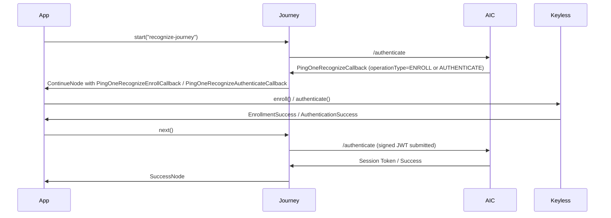

[](https://github.com/ForgeRock/ping-android-sdk)

# Recognize Module: PingOne Recognize Biometric Authentication

## Overview

The `recognize` module integrates [PingOne Recognize](https://docs.pingidentity.com/recognize/pingone-recognize.html) (powered by the Keyless biometric SDK) into both **Journey** and **DaVinci**-based authentication flows on Android. It handles biometric **enrollment** (registering a user's face) and **authentication** (verifying a returning user) through standard Journey callbacks and DaVinci collectors.

The module registers its callbacks and collectors automatically via AndroidX App Startup — no manual initialisation is required in your `Application` class.

### Supported operation types

| `operationType` | Purpose                           |
|-----------------|-----------------------------------|
| `ENROLL`        | Biometric enrollment ceremony     |
| `AUTHENTICATE`  | Biometric authentication ceremony |

---

## Requirements

- Android API 29+
- Java 17
- Kotlin coroutines

---

## Installation

```kotlin
implementation("com.pingidentity.sdks:recognize:<version>")
```

---

## Prerequisites: Journey / DaVinci Configuration

Configure a Journey or DaVinci flow in PingOne AIC that includes a **PingOne Recognize** node. The node produces either:

- A `PingOneRecognizeCallback` (Journey) with `operationType = "ENROLL"` or `"AUTHENTICATE"`
- A DaVinci connector response with the same `operationType` discriminator

All SDK parameters (API key, host, transaction data, liveness settings, etc.) are supplied by the server as output fields — the SDK maps them to `BiomEnrollConfig` / `BiomAuthConfig` automatically.

---

## Journey Integration

### How it works



Registration and Keyless SDK initialisation happen automatically at app startup — the `RecognizeKeylessInitializer` is declared as a dependency of `CallbackInitializer` in the module's `AndroidManifest.xml`.

### Handling the callback

The Journey framework returns either `PingOneRecognizeEnrollCallback` or `PingOneRecognizeAuthenticateCallback` depending on `operationType`. Call `enroll()` or `authenticate()` on the resolved callback, then advance the flow:

```kotlin
for await node in journey.start() {
    when (node) {
        is ContinueNode -> {
            node.callbacks.forEach { callback ->
                when (callback) {
                    is PingOneRecognizeEnrollCallback -> {
                        val result = callback.enroll()
                        result.onFailure { error ->
                            if (error is RecognizeException) {
                                Log.e("Recognize", "Enroll failed [${error.code}]: ${error.message}")
                            }
                        }
                    }
                    is PingOneRecognizeAuthenticateCallback -> {
                        val result = callback.authenticate()
                        result.onFailure { error ->
                            if (error is RecognizeException) {
                                Log.e("Recognize", "Auth failed [${error.name}]: ${error.message}")
                            }
                        }
                    }
                }
            }
            node.next()
        }
        is SuccessNode -> { /* authenticated */ }
        is FailureNode -> { /* journey-level failure */ }
    }
}
```

#### Retrieving the selfie frame (optional)

Both callbacks accept a `retrieveSelfie: Boolean` parameter. When `true`, the captured face frame is returned in `RecognizeSuccess.selfie` as a `Bitmap`. Every successful enroll or authenticate operation also retrieves the current device public signing key from the Keyless SDK and exposes it as `RecognizeSuccess.devicePublicSigningKey`. Key and user-ID retrieval are best-effort, mirroring the iOS SDK: if a lookup fails after the ceremony has succeeded, the operation still succeeds, the affected `RecognizeSuccess` property is `null`, and the corresponding input field is left untouched on the Journey callback.

```kotlin
val result = callback.enroll(retrieveSelfie = true)
result.onSuccess { success ->
    val selfie: Bitmap? = success.selfie
}
```

### Enrollment — server field mapping

| Callback field / `mobileSDKOptions` key         | `BiomEnrollConfig` property             |
|-------------------------------------------------|-----------------------------------------|
| `transactionData`                               | `jwtSigningInfo.claimTransactionData`   |
| `audience`                                      | `jwtSigningInfo.audience`               |
| `clientState`                                   | `clientState`                           |
| `generateClientState` (`"true"` → BACKUP)       | `generatingClientState`                 |
| `mobileSDKOptions.operationInfoId`              | `operationInfo.operationId`             |
| `mobileSDKOptions.operationInfoPayload`         | `operationInfo.payload`                 |
| `mobileSDKOptions.operationInfoExternalUserId`  | `operationInfo.externalUserId`          |
| `mobileSDKOptions.livenessConfiguration`        | `livenessConfiguration`                 |
| `mobileSDKOptions.livenessEnvironmentAware`     | `livenessEnvironmentAware`              |
| `mobileSDKOptions.cameraDelaySeconds`           | `cameraDelaySeconds`                    |
| `mobileSDKOptions.showSuccessFeedback`          | `showSuccessFeedback`                   |
| `mobileSDKOptions.showFailureFeedback`          | `showFailureFeedback`                   |
| `mobileSDKOptions.showInstructionsScreen`       | `showInstructionsScreen`                |
| `mobileSDKOptions.presentation`                 | `presentationStyle`                     |
| `mobileSDKOptions.numberOfEnrollmentCircuits`   | `setupConfig.numberOfEnrollmentCircuits`|

On success, `IDToken1signedJwt`, `IDToken1clientState`, `IDToken1recognizeId`, and `IDToken1devicePublicSigningKey` are submitted to the server automatically.

### Authentication — server field mapping

| Callback field / `mobileSDKOptions` key                  | `BiomAuthConfig` property               |
|----------------------------------------------------------|-----------------------------------------|
| `transactionData`                                        | `jwtSigningInfo.claimTransactionData`   |
| `audience`                                               | `jwtSigningInfo.audience`               |
| `generateClientState` (`"true"` → BACKUP)                | `generatingClientState`                 |
| `mobileSDKOptions.operationInfoId`                       | `operationInfo.operationId`             |
| `mobileSDKOptions.operationInfoPayload`                  | `operationInfo.payload`                 |
| `mobileSDKOptions.operationInfoExternalUserId`           | `operationInfo.externalUserId`          |
| `mobileSDKOptions.livenessConfiguration`                 | `livenessConfiguration`                 |
| `mobileSDKOptions.livenessEnvironmentAware`              | `livenessEnvironmentAware`              |
| `mobileSDKOptions.cameraDelaySeconds`                    | `cameraDelaySeconds`                    |
| `mobileSDKOptions.showSuccessFeedback`                   | `showSuccessFeedback`                   |
| `mobileSDKOptions.presentationStyle`                     | `presentationStyle`                     |
| `mobileSDKOptions.shouldRetriveAuthenticationFrame`      | `shouldRetrieveAuthenticationFrame`     |
| `mobileSDKOptions.numberOfEnrollmentCircuits`            | `setupConfig.numberOfEnrollmentCircuits`|

> **Note:** `shouldRetriveAuthenticationFrame` preserves the server-side typo (missing `e` in `Retrieve`) — this is the exact JSON key the server sends.

On success, `IDToken1signedJwt`, `IDToken1clientState`, `IDToken1recognizeId`, and `IDToken1devicePublicSigningKey` are submitted automatically. For pure authentication, `IDToken1recognizeId` is freshly retrieved from `Keyless.getUserId()`; the client-state enrollment fallback uses `EnrollmentSuccess.keylessId`. The signing key is freshly retrieved from the Keyless SDK for each successful authentication. The user-ID and signing-key lookups are best-effort: if a lookup fails after the ceremony has succeeded, the operation still succeeds and the corresponding input field is left untouched. Journey enrollment submits the same six-input contract, with `EnrollmentSuccess.keylessId` as the recognize ID and the signing key freshly retrieved after each successful enrollment (also best-effort).

#### Enroll-from-clientState (auth flow)

When the authenticate callback receives a non-empty `clientState` and `validateUserAndDeviceActive()` reports the user is not yet enrolled, it automatically falls back to `Recognize.enroll()` using that `clientState`. No extra handling is needed from the caller.

---

## DaVinci Integration

The module registers a `RecognizeCollector` factory automatically via `CollectorInitializer`. It reads the `operationType` field and returns either `RecognizeEnrollCollector` or `RecognizeAuthenticateCollector`, both of which implement `Collector<JsonObject>`.

The collectors chain `Recognize.setup → Recognize.enroll / Recognize.authenticate` and populate `formData.{key}` with a flat JSON object on both success and failure paths, so the server always receives a response including `clientError` and `clientErrorCode`.

DaVinci error mapping is partially implemented — `RecognizeException` failures are fully mapped (shared `code` in `clientErrorCode`, human `message` in `clientError`); non-Recognize exceptions populate `clientError` only (code is empty, pending full DaVinci error mapping).

---

## Error Handling

On failure, `Recognize.enroll()` / `Recognize.authenticate()` (and the Journey/DaVinci collectors wrapping them) return a `RecognizeException` and automatically populate `IDToken1clientError` and `IDToken1clientErrorCode` before the Journey submits the response. `IDToken1clientError` carries the shared error name (e.g. `CORE_USER_NOT_ENROLLED`) and `IDToken1clientErrorCode` carries the shared code. An error that has no shared name, including an error raised on-device, is reported as `SDK_ERROR` (`IDToken1clientErrorCode` = `1000`), like on the web SDK. The human-readable text stays in `RecognizeException.message`.

`RecognizeException` exposes the shared cross-platform error model — the same codes and names the web Recognize SDK returns (e.g. `CORE_USER_NOT_ENROLLED` / 3003). Keyless SDK errors are mapped from their native codes to the shared model; unmapped native codes, and errors raised on-device, fall back to `SDK_ERROR` (1000).

```kotlin
class RecognizeException(
    val code: Int,                          // the shared cross-platform error code (1000 for errors raised entirely on-device)
    val name: String?,                      // the shared error name (e.g. "CORE_USER_NOT_ENROLLED"; "SDK_ERROR" for on-device errors)
    override val message: String,           // the human-readable text from the underlying Keyless SDK error
    val sdkCode: Int?,                      // the native Keyless SDK error code (null for on-device errors), kept for debugging
    val debuggingInfo: Map<String, String>, // diagnostic keys such as flowId, sessionId, and stacktrace when available (for errors converted from a native Keyless error, also includes "sdkCode")
    cause: Throwable? = null,
) : Exception(message, cause)
```

### Error code mapping

The table below maps the native Keyless SDK error codes to the shared Recognize error model (version 6.0.0). The shared codes and names are the same on the web, Android, and iOS Recognize SDKs. In your app, branch on `RecognizeException.code` or `RecognizeException.name`, or on the public `SharedErrorCode` enum (e.g. `SharedErrorCode.CORE_USER_NOT_ENROLLED`, or `.name` for the string) for compile-time-checked values; the Journey receives the shared name in the `clientError` input and the shared code in the `clientErrorCode` input. The table also lives in `nativeToShared` in `SharedErrorCode.kt`.

| Native Keyless code | Shared code | Shared name |
|---|---|---|
| 10000 | 1000 | `SDK_ERROR` |
| 10001 | 1009 | `SDK_ARTIFACT_RETRIEVE_FAILED` |
| 10003 | 1003 | `SDK_LOGGING_CONFIGURATION_FAILED` |
| 10004 | 2000 | `CAMERA_ERROR` |
| 10005 | 1004 | `SDK_STORAGE_FAILED` |
| 10006 | 1016 | `SDK_INVALID_CUSTOMER_PROPERTIES` |
| 10100 | 4000 | `BIOM_ERROR` |
| 10200 | 3000 | `CORE_ERROR` |
| 20000 | 3003 | `CORE_USER_NOT_ENROLLED` |
| 20001 | 3002 | `CORE_USER_ALREADY_ENROLLED` |
| 20002 | 1001 | `SDK_NOT_CONFIGURED` |
| 20010 | 1002 | `SDK_INVALID_CONFIGURATION` |
| 20013 | 3001 | `CORE_NOT_ENOUGH_API_KEY_SEATS` |
| 20021 | 4003 | `BIOM_LIVENESS_ENVIRONMENT_AWARE_NOT_SUPPORTED` |
| 20022 | 4004 | `BIOM_DEVICE_ENVIRONMENT_AWARE_NOT_SUPPORTED` |
| 20023 | 1010 | `SDK_INVALID_CLIENT_STATE` |
| 20150 | 1008 | `SDK_DYNAMIC_LINKING_PAYLOAD_MALFORMED` |
| 20300 | 3006 | `CORE_SECRET_NOT_FOUND` |
| 30000 | 4002 | `BIOM_GENUINE_PRESENCE_NOT_ESTABLISHED` |
| 30001 | 1006 | `SDK_TIMEOUT` |
| 30003 | 1005 | `SDK_USER_CANCELLED` |
| 30004 | 3004 | `CORE_FACE_NOT_MATCHING` |
| 30005 | 1007 | `SDK_NO_NETWORK_CONNECTION` |
| 30007 | 3007 | `CORE_USER_LOCKED_OUT` |
| 30008 | 4001 | `BIOM_REJECTED` |
| 30009 | 2002 | `CAMERA_PERMISSION_DENIED` |
| 30010 | 1012 | `SDK_OUTDATED_APP` |
| 40000 | 6000 | `SECURITY_ERROR` |
| 40002 | 6001 | `SECURITY_DEVICE_NOT_GENUINE` |
| *unmapped native code, or an error raised on-device* | 1000 | `SDK_ERROR` (fallback) |

Note: the codes and names are shared, but each platform reports the errors it can detect, and the same user state can be reported differently on purpose — e.g. a not-enrolled user is a client-side check on mobile (`CORE_USER_NOT_ENROLLED`) but a server-side event on web (`SERVER_ERROR`), where revealing enrollment state would enable enumeration attacks.

```kotlin
result.onFailure { error ->
    if (error is RecognizeException) {
        Log.e("Recognize", "Error ${error.name ?: "UNKNOWN"} (${error.code}): ${error.message}")
        Log.d("Recognize", "Debugging info: ${error.debuggingInfo}")
    }
}
```

---

## Troubleshooting

| Symptom | Possible Cause | Fix |
|---------|----------------|-----|
| `Keyless.configure` returns error | Wrong API key or host | Verify the values in the Journey/DaVinci node output |
| Camera never opens | Missing foreground `Activity` or wrong thread | Ensure `enroll()`/`authenticate()` is called from the main thread with a visible activity |
| Journey returns generic error after biometric success | Double submission | The callbacks submit inputs automatically — do **not** call `input()` manually |
| Liveness check too strict / lenient | Server default not suitable | Adjust `livenessConfiguration` in the AIC node settings |
| `"operationType" is required` | Journey/DaVinci node misconfigured | Check the PingOne Recognize node configuration in AIC |
| `RecognizeException.code` is always 1000 (`SDK_ERROR`) with an unexpected `sdkCode` | Keyless native code missing from the shared mapping | File an issue with the `sdkCode` value — until mapped, the fallback reports `SDK_ERROR` |

---

## License

This project is licensed under the MIT license. See the [LICENSE](../LICENSE) file for details.
